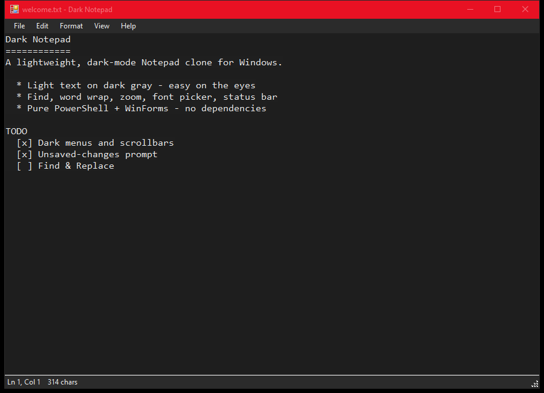

<div align="center">

# Dark Notepad

**A free, open-source dark mode Notepad alternative for Windows 10 & 11.**
Light text on dark gray. Lightweight. No dependencies. No telemetry.

[](https://github.com/248Tech/DarkNotepad/actions/workflows/ci.yml)
[](https://github.com/248Tech/DarkNotepad/releases/latest)
[](https://github.com/248Tech/DarkNotepad/releases)
[](LICENSE)
[](#install)
[](https://learn.microsoft.com/powershell/)
[](https://github.com/248Tech/DarkNotepad/stargazers)
[](CONTRIBUTING.md)

### [Try the live demo](https://248tech.github.io/DarkNotepad/) &nbsp;|&nbsp; [Download](https://github.com/248Tech/DarkNotepad/releases/latest) &nbsp;|&nbsp; [Changelog](CHANGELOG.md)



</div>

## Why Dark Notepad?

Classic Notepad blinds you at 2 a.m. Dark Notepad is a small, readable, hackable text editor that is dark everywhere: the editor, the menus, the dropdowns, the status bar and the scrollbars. It is also a compact example of a fully themed WinForms app written in pure PowerShell.

## Features

- **True dark mode:** light text (`#EBEBEB`) on dark gray (`#1E1E1E`), with custom-rendered dark menus and status bar
- **Familiar editing:** New, Open, Save, Save As, Undo/Redo, Cut/Copy/Paste, Select All, Time/Date (`F5`)
- **Find** with match-case, **Word Wrap**, **Font picker**, **Zoom** in/out
- **Status bar:** line, column and character count
- **Safe saving:** prompts before discarding unsaved changes; UTF-8 without BOM
- **Open with file:** `DarkNotepad.vbs notes.txt`
- **Private:** no network access, no telemetry, no accounts
- **Zero dependencies:** runs on the Windows PowerShell 5.1 already on your PC

## Install

Requires **Windows 10 or 11** (Windows PowerShell 5.1, preinstalled).

### One-line install (per-user, no admin)

```powershell
irm https://raw.githubusercontent.com/248Tech/DarkNotepad/main/install.ps1 | iex
```

This installs to `%LOCALAPPDATA%\DarkNotepad` and adds a **Dark Notepad** Start Menu shortcut.
Add `-Desktop` for a desktop shortcut (run the script from a clone/extracted zip: `.\install.ps1 -Desktop`).

### Download a release

1. Download `DarkNotepad-x.y.z.zip` from [Releases](https://github.com/248Tech/DarkNotepad/releases/latest).
2. *(Optional)* verify the checksum: `(Get-FileHash .\DarkNotepad-x.y.z.zip).Hash` against the `.sha256` file.
3. Extract, then double-click `DarkNotepad.vbs` or run `.\install.ps1`.

### Run from source

```powershell
git clone https://github.com/248Tech/DarkNotepad.git
cd DarkNotepad
powershell -STA -ExecutionPolicy Bypass -File .\DarkNotepad.ps1 [file.txt]
```

### Uninstall

```powershell
.\install.ps1 -Uninstall
```

> **SmartScreen / Defender warning?** The scripts are not code-signed. The whole app is one readable file ([`DarkNotepad.ps1`](DarkNotepad.ps1)). Read it before you run it.

## Keyboard shortcuts

| Action | Shortcut |
| --- | --- |
| New / Open / Save / Save As | `Ctrl+N` / `Ctrl+O` / `Ctrl+S` / `Ctrl+Shift+S` |
| Undo / Redo | `Ctrl+Z` / `Ctrl+Y` |
| Cut / Copy / Paste / Select All | `Ctrl+X` / `Ctrl+C` / `Ctrl+V` / `Ctrl+A` |
| Find | `Ctrl+F` |
| Insert time/date | `F5` |
| Zoom in / out | `Ctrl+Plus` / `Ctrl+Minus` |

## Roadmap

- [ ] Find & Replace, Go To Line
- [ ] Printing
- [ ] Remember window size, font and word-wrap
- [ ] Optional light theme toggle
- [ ] Signed releases / winget package

Have an idea? [Open a feature request](https://github.com/248Tech/DarkNotepad/issues/new/choose).

## Contributing

Contributions are welcome. See [CONTRIBUTING.md](CONTRIBUTING.md) and the [Code of Conduct](CODE_OF_CONDUCT.md). Report vulnerabilities per [SECURITY.md](SECURITY.md).

## FAQ

**Is it a replacement for Windows Notepad?** It covers the everyday basics (edit, find, wrap, zoom, save). It deliberately skips advanced features to stay tiny.

**Does it work on PowerShell 7?** It targets Windows PowerShell 5.1. PowerShell 7 on Windows should also work, but 5.1 is what is tested.

**Is the web demo the real app?** No. The [live demo](https://248tech.github.io/DarkNotepad/) is an in-browser replica of the interface. The real app is a native Windows program.

## License

[MIT](LICENSE) © 2026 [248Tech](https://github.com/248Tech)

<sub>Keywords: dark notepad, dark mode notepad, notepad dark theme, Windows text editor, notepad alternative, PowerShell WinForms example, open source text editor.</sub>
